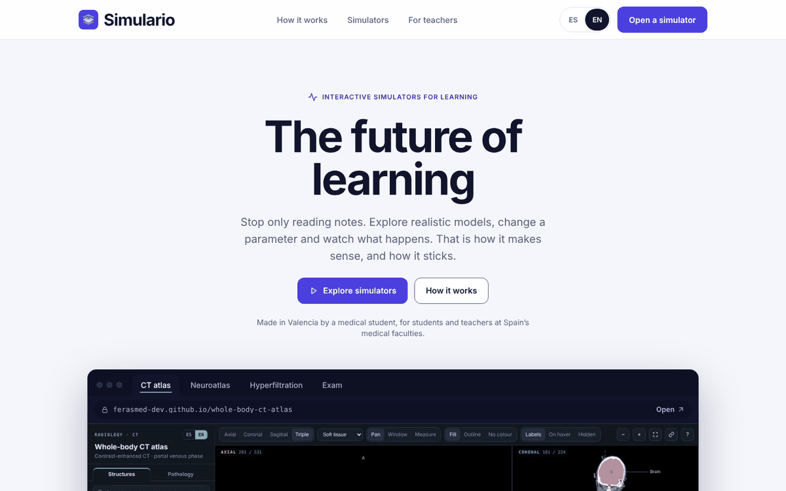

# Simulario · landing page

**Live:** https://ferasmed-dev.github.io/simulario-site/ · English: https://ferasmed-dev.github.io/simulario-site/en/

The website of **Simulario**, a collection of interactive simulators for learning medicine: instead of only reading notes, students explore realistic models, change a parameter and watch what happens. Spanish first, with an English version.



## What's on the page

- **Hero showcase**: a browser window that plays short recordings of the real apps, one tab each, pausing 1 s before sliding to the next:
  1. **Atlas TC** — the [whole-body CT atlas](https://github.com/ferasmed-dev/whole-body-ct-atlas) in triple view, scrolling from the aortic arch to the heart with its segmentations and labels, ending on the hover tooltip.
  2. **Neuroatlas** — the 3D brain model and the 7 T MRI slice from the neuroanatomy atlas (preview, not public yet, so this tab has no link).
  3. **Hiperfiltración** — the [glomerular hyperfiltration simulator](https://github.com/ferasmed-dev/simulator-glomerular-of-hyperfiltration) running its *HTA mantenida* scenario over 30 years.
  4. **Examen** — the CT atlas exam mode: "¿Qué lesión es?", answered correctly.

  Visitors can click any tab; the address bar opens the live app. With *reduce motion* switched on, nothing autoplays and each tab shows its final frame.
- **Cómo funciona** (explore · change · observe), the **simulator catalogue**, a CT-atlas section, **for students / for teachers**, a final call to action and the footer.
- Scroll-in and hover animations are CSS only and stay subtle.

## Layout

```
index.html            Spanish page (default)
en/index.html         English page
src/styles.css        all styles (Simulario brand colours, type and radii)
src/main.js           hero showcase player (no libraries)
assets/brand/         logo, favicons, app icon
assets/frames/        showcase frames (WebP, 1280 × 800), recorded from the apps
assets/og.jpg         social preview image
tests/site.test.js    static checks (links, assets, both languages)
docs/screenshot.png
```

Plain HTML, CSS and JavaScript: no build step, no frameworks. Fonts (Space Grotesk, Inter, JetBrains Mono) load from Google Fonts, as the brand guidelines specify; system fonts are the fallback.

## Editing

- **Copy**: edit the text in `index.html` and `en/index.html` directly. Keep the two pages in step (the tests check that both have the same sections and showcase).
- **Links**: the *Autorregulación renal* card still points to `#`; replace it with the simulator's URL when it is published.
- **Showcase timing**: `STEP` (ms per frame) and `HOLD` (pause between slides, 1000 ms) at the top of `src/main.js`.
- **New recordings**: replace the files in `assets/frames/` keeping the same names and 1280 × 800 size; if the number of frames changes, add or remove the matching `` lines in both pages.

## Run locally

```
python3 -m http.server 8000
# open http://localhost:8000  (English: http://localhost:8000/en/)
```

## Tests

```
npm test
```

Checks that every local file the pages point to exists, that the Spanish and English pages have the same structure and showcase (4 tabs, 38 frames), that language links and `hreflang` alternates are in place, and that the showcase script parses. GitHub Actions runs them on every push.

## Deploy (GitHub Pages)

1. Create an empty **public** repository named `simulario-site` (no README or licence).
2. Push these files to `main` (they must sit at the root, with `index.html` at the top).
3. **Settings → Pages → Deploy from a branch → `main` / `(root)`**.
4. After 1–2 minutes the site is live at `https://ferasmed-dev.github.io/simulario-site/`.

To use a custom domain later (e.g. `simulario.es`), add it under Settings → Pages and update the `canonical`, `hreflang` and `og:` URLs in both pages.

## Credits

- CT images: TotalSegmentator dataset, case s0591 (Wasserthal J. et al., *Radiology: AI* 2023), CC BY 4.0, as used in the whole-body CT atlas.
- Brain images: Lüsebrink F, Mattern H, Yakupov R, et al. *Comprehensive ultrahigh resolution whole brain in vivo MRI dataset as a human phantom.* Sci Data 2021;8:138 (data CC0); segmentation with SynthSeg (Billot B, et al. *Med Image Anal* 2023).

Teaching tools · not for clinical use.

© 2026 Feras Elhissi. All rights reserved (see `LICENSE`).
